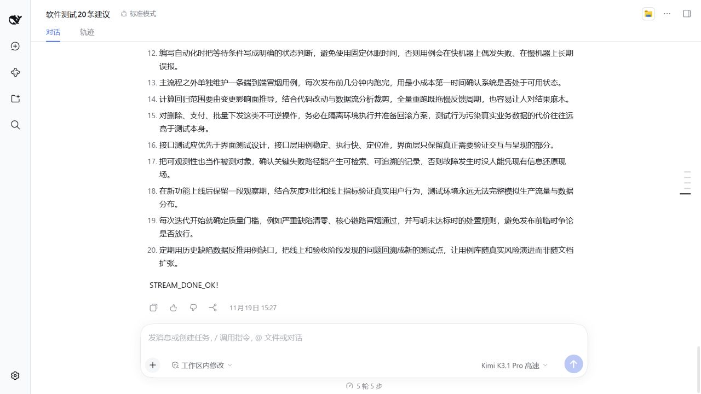
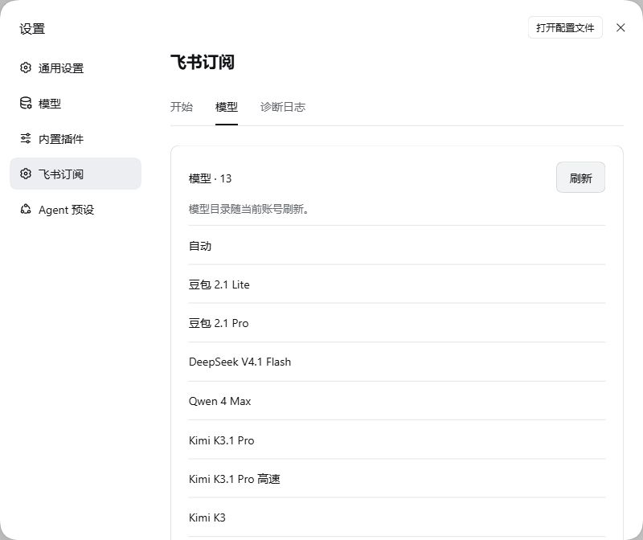
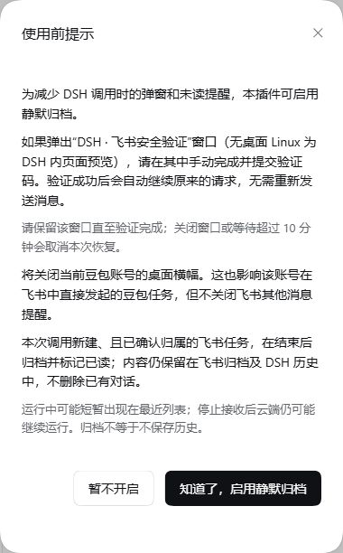

# 飞书豆包工作订阅 · DSH 插件

**通过飞书账号登录，把豆包工作的企业订阅模型接入 DeepSeek Harness（DSH），使用账号已有的企业额度，在 DSH 中聊天、编程和执行任务。**

项目的目的，是让已有飞书企业订阅的用户，在 DSH 的工作流中直接使用自己有权限的模型，无需另行配置模型 API Key。可用模型和额度权限以当前飞书账号为准。

当前版本：**v0.4.0 · 跨平台预发布版**。独立开发，非飞书、豆包或 DeepSeek 官方插件。

## 支持什么

- 飞书登录、添加账号、切换账号和退出登录。
- 动态获取账号可用的豆包、DeepSeek、Kimi、GLM 等模型。
- 文本流式回复，以及由 DSH 执行的工具调用。
- 查看当前账号的企业套餐用量明细。
- 可选静默归档：关闭当前豆包账号的桌面横幅，调用结束后归档本次新建的任务并标记已读，减少打扰。
- 诊断日志，方便排查验证码、连接中断和上游错误。

## 实机截图

以下为 Windows 实机上的 DSH Web 界面；回复来自已完成的真实模型验收会话。

**Kimi 长回复完成，正文保留到结束标记：**



**从当前飞书账号动态读取模型目录（截图显示部分模型）：**



**首次使用说明：人工验证码恢复、通知设置与任务归档：**



## 安装

先在 DSH 所在机器安装 **Google Chrome**，并准备有对应模型权限的飞书账号。

**桌面 DSH：**打开「插件 → 添加插件」，输入仓库地址，或从 [Releases](https://github.com/advance-lion/dsh-feishu-subscription/releases) 下载 `.tgz` 安装包后安装并启用。

```text
https://github.com/advance-lion/dsh-feishu-subscription
```

也支持选择本地解包目录。桌面版的安装、升级请通过应用内插件管理器完成。

**CLI / Web：**需要 Node.js 22+，并安装 `pnpm`。

```sh
dsh plugin --profile <你的Profile> add <安装包绝对路径>
dsh --profile <你的Profile>
```

## 开始使用

1. 打开「设置 → 飞书订阅 → 添加账号」，按提示扫码登录。
2. 在会话的模型菜单中选择「飞书 · 豆包工作（企业订阅）」下的模型。
3. 发送消息，即可使用当前账号的企业订阅模型。

**如弹出安全验证码，请手动完成并提交；验证成功后会自动继续原请求，无需重复发送消息。** 无桌面 Linux 会在 DSH 内显示登录和验证页面预览。

首次启用时会说明静默归档的影响，由用户选择是否开启。横幅设置也会影响同一账号在飞书中直接发起的豆包任务；归档内容仍保留在飞书和 DSH 历史中。

## 平台与当前限制

- **Windows：**已有真实企业账号的调用、流式回复和归档验收。
- **macOS / Linux Web：**已通过跨平台 CI、原生钥匙串和 DSH 宿主检查；真实企业账号的端到端验收仍待完成。
- Linux 需要可用的 Secret Service，或配置固定的 `FEISHU_SUBSCRIPTION_VAULT_KEY`。具体步骤见[配置与使用详解](https://github.com/advance-lion/dsh-feishu-subscription/blob/main/docs/GUIDE.md)。
- 当前仅支持文本；企业套餐总额和剩余额度尚未打通，显示的用量仅属于当前账号。
- 归档不是“不保存历史”，运行中的任务可能短暂出现在飞书最近列表。上游分批返回时，正文显示也可能有停顿。
- 工具请求不完整时会明确报错；诊断页可查看实际输入字节数、模型目录窗口和上游结束原因。目录声明的窗口大小不代表已验证的可用输入容量。

登录凭据在本机加密保存；模型调用会将 DSH 提供的文本历史发送到豆包工作。更多配置、数据说明和排查方法见[使用详解](https://github.com/advance-lion/dsh-feishu-subscription/blob/main/docs/GUIDE.md)。
